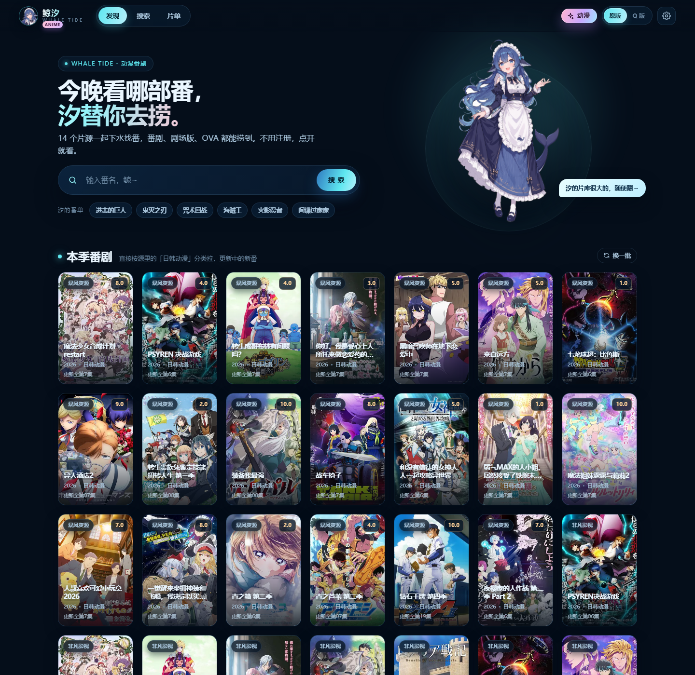
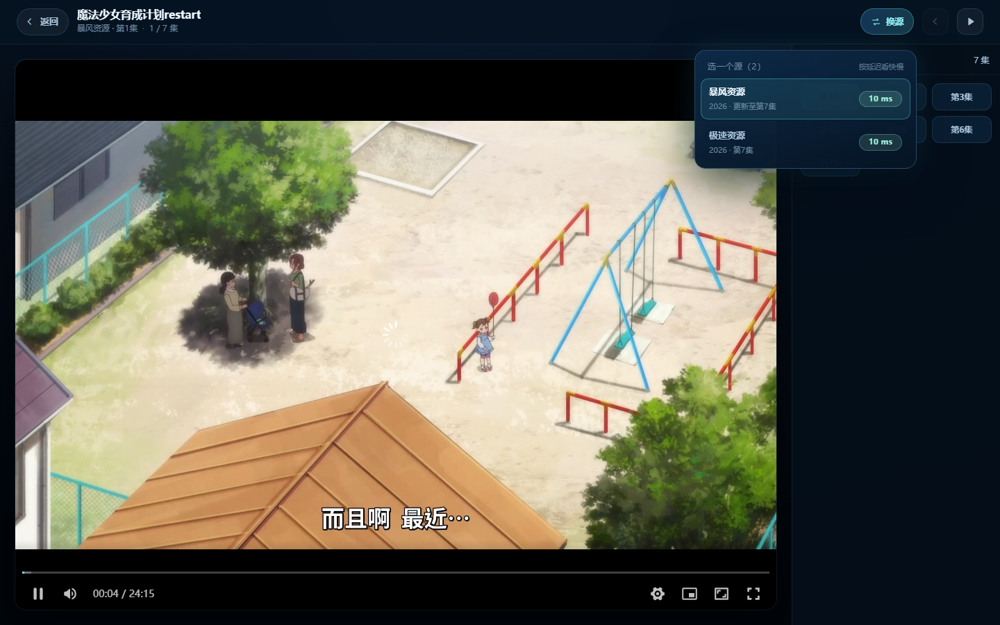
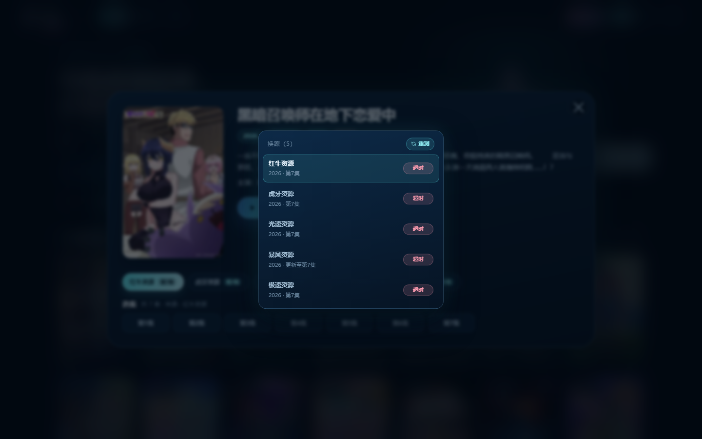
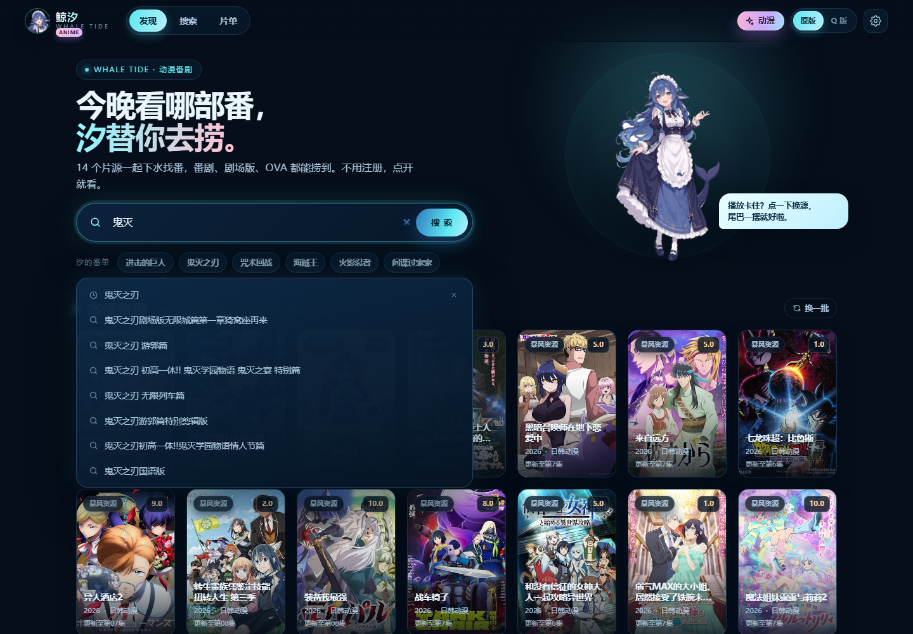
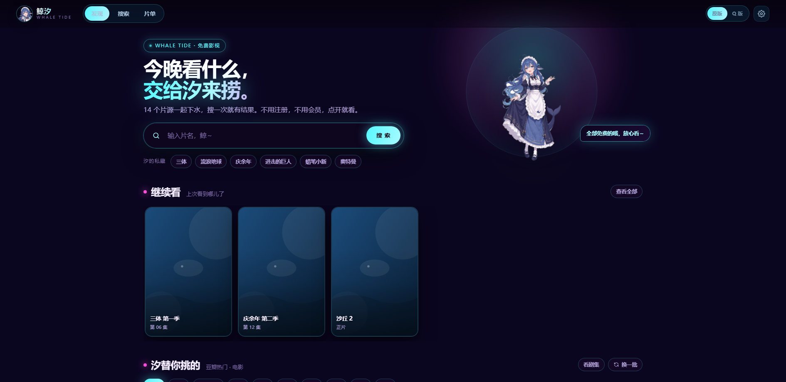

# 鲸汐 WhaleTide

鲸鱼娘主题的免费影视站，**从零写的单页应用**（不是给 LibreTV 套皮）。

- 纯静态前端（HTML + CSS + 原生 JS，无框架、无构建）
- Cloudflare Pages Functions 做代理（流式透传 + M3U8 重写）
- 立绘：社区「鲸鱼娘」开源素材（CC BY-NC-SA 4.0）



| 播放 | 换源 |
|---|---|
|  |  |

| 搜索联想 | 赛博霓虹主题 |
|---|---|
|  |  |

---

## 一、功能

| 模块 | 说明 |
|---|---|
| 发现页 | 大标题 hero + 搜索框 + 热搜 chips + **继续看（置顶，跟在 hero 后面）** + 豆瓣热门（电影/剧集切换、标签、换一批）+ 片源状态 |
| 影视 / 动漫 双模式 | 顶栏右上「影视 / 动漫」按钮一键切换；两套模式有**独立的片源、观看记录、收藏**，互不串；动漫模式下标题、热搜、豆瓣区都换成番剧口径 |
| 搜索 | 多源并发（单源 4.5s 超时），同名作品自动合并成一部，详情里可切源；**输入时给联想词**（本地历史 + 热搜 + 源实时标题），**保存最近搜索**（按模式隔离，可单条删/清空）；**动漫模式按分类过滤**（动漫/动画/番剧/OVA/剧场版…） |
| 详情 | 侧滑浮层：海报 / 评分 / 类型 / 简介 / 主演 / **收藏** / 源标签 / 选集网格 |
| 收藏 | 卡片右上角星标一键收藏；详情页「收藏」按钮；片单页分「观看记录 / 我的收藏」两个 tab |
| 播放 | 全屏影院：ArtPlayer + hls.js，播放器圆角浮起 + 毛玻璃头部，右侧选集网格（不再被拉成竖条），上一集 / 下一集，自动连播；**顶部「换源」一键挑源（只有单源时现场搜其它源），播放报错 / 分片挂掉会自动切下一个源并保留集序号** |
| 片单 | 观看记录（本机 localStorage），进度条、按时间排序、单条删除；收藏可单条取消或全清 |

### 番剧是怎么来的（动漫模式）

不靠关键词碰运气，直接走源的**分类接口**：

1. `GET {源}/api.php/provide/vod/?ac=list` 拿分类表（返回 `class[]`，含 `type_id` / `type_name`）
2. 按 `WT.ANIME_CLASS_PRIORITY` 挑分类：`日韩动漫 → 日本动漫 → 番剧 → 日本动画 → 动漫 → 动画片`（跳过国产少儿向）
3. `GET {源}/api.php/provide/vod/?ac=videolist&t=<type_id>&pg=<页码>` 拉列表

实测（暴风资源 `type_id=41 日韩动漫`）返回的是真新番：

```
魔法少女育成计划 restart | 日韩动漫 | 2026 | 更新至第7集
PSYREN 决战游戏        | 日韩动漫 | 2026 | 更新至第6集
转生成哥布林有问题吗？   | 日韩动漫 | 2026 | 更新至第7集
七龙珠超：比鲁斯        | 日韩动漫 | 2026 | 更新至第6集
```

分类表缓存在 `sessionStorage`（1 天），「换一批」就是翻页（pg 1→5 循环）。

> 日番资源站几乎都不做标准苹果 CMS V10（多是自己那套 API + TVBox py 源），
> 所以不要去找"日番 CMS 站"，用综合站的「日韩动漫」分类最稳。

### 双模式的数据隔离

| 数据 | 影视 | 动漫 |
|---|---|---|
| 片源选择 | `wt_sites` | `wt_sites_anime` |
| 观看记录 | `wt_history_video` | `wt_history_anime` |
| 我的收藏 | `wt_favs_video` | `wt_favs_anime` |
| 当前模式 | `wt_mode`（`video` / `anime`） | |
| 设置 | 片源多选（14 个内置源）、形象切换、**背景主题（5 套）**、数据迁移、清空数据 |
| 背景主题 | **9 套风格**（见下表），设置里一键切换，存 `wt_bg` |

### 九套风格

| key | 名字 | 类型 | 视觉特征 |
|---|---|---|---|
| `deep` | 深海夜 | 暗 | 深蓝 + 光柱 + 上浮气泡（默认） |
| `aurora` | 极光湾 | 暗 | 青绿 × 紫罗兰双极光 |
| `dawn` | 晨雾海面 | 暗 | 蓝紫水面 + 暖橘地平线 |
| `lagoon` | 浅海潟湖 | 暗 | 青绿通透、波纹更亮 |
| `sakura` | 樱粉 | 亮 | 粉白渐变 + **樱花花瓣飘落** + 粉色按钮/标题 |
| `candy` | 糖果玻璃 | 亮 | 青粉紫三色光 + **真玻璃卡片** + 彩虹渐变描边 |
| `paper` | 月白 | 亮 | 白蓝极简，深色文字 |
| `neon` | 赛博霓虹 | 暗 | 暗紫黑 + **霓虹网格线** + 青/洋红发光描边 |
| `retro` | 复古胶片 | 亮 | 米黄纸感 + **噪点纹理** + 硬阴影方块 + 暖褐配色 |
| 形象切换 | 原版立绘 / Q 版，顶栏一键切，记在 `localStorage.wt_style` |
| 密码门 | `PASSWORD` 环境变量 → 前端只拿到 sha256，代理请求带 `auth` 校验 |
| 响应式 | ≥900px 顶栏导航；<720px 底部 tab 栏 + 单列 hero |
| 本地演示 | 任意页面加 `?mock=1` 用假数据看完整界面 |

---

## 二、目录

```
index.html                  单页外壳（顶栏 / 视图容器 / 浮层 / 底栏）
assets/css/site.css         设计系统（深海蓝 tokens、卡片、浮层、播放层）
assets/js/config.js         片源列表、超时、热搜词、台词
assets/js/core.js           DOM/存储/鉴权/代理/接口/路由/提示（含 ?mock=1 假数据）
assets/js/app.js            发现 / 搜索 / 片单 / 设置 / 详情浮层
assets/js/player.js         ArtPlayer + hls.js 播放层
assets/vendor/              artplayer.min.js / hls.min.js / sha256.min.js
assets/img/                 立绘 girl.png、chibi.png、头像、图标
functions/_middleware.js    把 {{PASSWORD}} 换成本地密码的 sha256
functions/proxy/[[path]].js 代理：M3U8 重写，其它流式透传（Range/206 保留）
manifest.json               PWA 清单
```

---

## 三、部署到 Cloudflare Pages

### 1) 新建项目（推荐）

```powershell
cd whale-tv
npx wrangler pages deploy . --project-name=whaletide
```

或者 Dashboard：Workers & Pages → Create → Pages → Upload assets → 拖 `whale-tv-dist.zip`。

### 2) 必填环境变量

| 变量 | 说明 |
|---|---|
| `PASSWORD` | **必填**。访问密码；前端只见 sha256，代理用同一个哈希鉴权 |
| `CACHE_TTL` | 可选，分片缓存秒数，默认 `3600` |
| `USER_AGENTS_JSON` | 可选，UA 数组 JSON |
| `DEBUG` | 可选，`true` 输出代理日志 |

没设 `PASSWORD` 会直接显示「还没设访问密码」提示页。

### 3) 想替换现有的 libretv-b4p

```powershell
npx wrangler pages deploy . --project-name=libretv-b4p
```

注意：这会把该项目的静态文件整体换掉（原 LibreTV 文件会被新站覆盖）。

---

## 四、本地预览

```powershell
node preview-whale.mjs        # 在 whale-tv 目录运行，本地密码 whale
# http://127.0.0.1:8231/?mock=1     假数据看界面
# http://127.0.0.1:8231/?mock=1&autoopen=1#/search?q=深海   自动打开详情
```

本地没有 Cloudflare Functions，`/proxy` 不可用；真实搜索/播放请部署后再试。

---

## 五、常见调整

| 想改什么 | 改哪里 |
|---|---|
| 加/删片源 | `assets/js/config.js` 的 `WT.SITES` |
| 默认启用哪些源 | `WT.CONFIG.defaultSites` |
| 搜索更快/更全 | `WT.CONFIG.searchTimeout`（3000～4500） |
| 首页热搜词 | `WT.HOT_WORDS` |
| 鲸鱼娘台词 | `WT.LINES` |
| 默认形象 | `assets/js/app.js` 里 `state.style` 读取的默认值，或 `Store.get('wt_style', 'mature')` 改成 `'chibi'` |
| 配色 | `assets/css/site.css` 顶部 `:root` tokens |
| 新增一套背景 | `assets/js/app.js` 的 `BG_THEMES` + `site.css` 第 27 节写 `body[data-bg="你的key"]` 变量与 `.sea::before` |

---

## 六、素材许可

立绘来自社区「鲸鱼娘」开源素材库：https://treapgogo.github.io/deepseek-whale-girl/

- 原型：B 站 UP 主「上善无形」原创角色「溟月」
- 女仆装二创：ZipZipPipe
- 授权：**CC BY-NC-SA 4.0**（署名、非商业、衍生同协议）

页脚已署名。商用前请自行联系原作者。

---

## 七、配置迁移（导出 / 导入，详细）

设置 → **数据迁移**。

### 1. 导出的文件是什么

点「导出配置」后浏览器会下载一个 `whaletide-config-YYYY-MM-DD.json`，内容长这样：

```json
{
  "app": "WhaleTide",
  "version": "2.0.0",
  "exportedAt": "2026-11-17T12:00:00.000Z",
  "style": "mature",
  "sites": ["ruyi", "bfzy", "ffzy", "tyyszy", "jisu"],
  "history": [
    { "id": "12345", "site": "ruyi", "siteName": "如意资源", "name": "片名",
      "epIndex": 3, "epName": "第 04 集", "total": 24, "time": 1763000000000 }
  ],
  "favorites": [
    { "id": "67890", "site": "bfzy", "siteName": "暴风资源", "name": "片名",
      "year": "2024", "type": "剧情", "note": "更新至 24 集", "score": "8.6",
      "addedAt": 1763000000000 }
  ]
}
```

就是纯文本，记事本也能打开改。

### 2. 文件落在哪

| 系统 | 默认位置 |
|---|---|
| Windows | `C:\Users\<用户名>\Downloads` |
| macOS | `~/Downloads` |
| Android | 文件管理 → 下载 / Download |
| iOS | 「文件」App → 下载项目 |

浏览器地址栏右侧的下载按钮也能直接「在文件夹中显示」。

### 3. 怎么「上传」（其实是导入回浏览器本地）

站点没有账号、没有服务端存储，**配置文件不会上传到任何服务器**，只是写回你这台浏览器的 localStorage。

三种导入方式：

| 方式 | 步骤 |
|---|---|
| A. 按钮选择 | 设置 → 数据迁移 → 点「导入配置」→ 系统文件选择框里选那个 json |
| B. 拖拽（桌面） | 把 json 文件直接拖到虚线框上，松手即导入 |
| C. 手机 | 设置 → 数据迁移 → 「导入配置」→ 系统文件选择器 → 下载 里选文件 |

### 4. 跨设备迁移

1. 在旧设备导出 json
2. 用微信 / QQ / 网盘 / U 盘 / 邮件把它传到新设备
3. 新设备打开站点（同一网址）→ 设置 → 数据迁移 → 导入
4. 片源选择、形象、片单立刻同步

### 5. 导入时会发生什么

| 项 | 行为 |
|---|---|
| 片源选择 | 覆盖当前选择；不认识的源 key 自动忽略 |
| 鲸鱼娘形象 | 跟随文件（`mature` / `chibi`） |
| 片单 | 覆盖；缺字段的记录自动忽略，最多保留 60 条 |
| 密码 | **不涉及**，密码在 Cloudflare 环境变量 `PASSWORD` 里 |
| 服务器 | 全程本地读写，不发起任何上传 |

### 6. 失败提示对照

| 提示 | 原因 |
|---|---|
| 这不是有效的 JSON 文件 | 文件不是 json，或下载不完整 |
| 这不是鲸汐导出的配置文件 | 文件里 `app` 不是 `WhaleTide` |
| 文件结构不对 | 顶层不是对象 |
| 文件里没有可用的片源/片单/形象设置 | 内容为空或字段全不合法 |
| 文件太大了 | 超过 4 MB（正常配置只有几十 KB） |

### 7. 换浏览器 / 清缓存前记得先导出

localStorage 跟着浏览器走：换浏览器、清站点数据、无痕模式关窗，都会丢。导出一份 json 就是最稳的备份。

